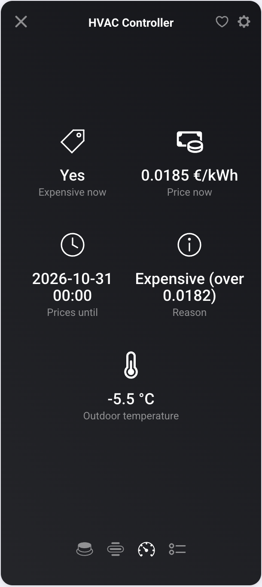

# HVAC Controller

The controller holds what all zones share. You can add only one.

- **Occupancy**: Present (someone is home), Coming Home (someone is on the way) or Away
  (nobody is home). Set it with the **Set occupancy** card, for example from presence or a
  geofence.
- **Season**: Heating, Cooling or Off.
- **Long absence**: on for trips of several days. All zones go to eco and nothing cools. To stop
  all heating and cooling, set the season to Off.
- **Price now**, in the currency set in the settings (default €).
- **Expensive now**: on during a price peak.
- **Prices until**: the last imported price.
- **Outdoor temperature**, from the sensor you picked. Zones with an outdoor limit use it. To pick
  another sensor, use **Repair** in the controller's device settings.
- **Heating power**, only when a zone has power meters: the sum of the zones' heating power.
  In Homey Energy, count either the controller, the zones or the meters, not more than one (see
  [Setup](Setup)).
- **Energy today**, **Cost today** and **Price paid today** of all zones with power meters, and
  **Average price today** (mean of today's prices so far). A price paid below the average means
  heating was moved to cheaper hours.
- **Reason**: why the price is expensive or not, for example `Normal`.

## Settings

- **Currency**, **Price model**, **Minimum price difference** and the **Percentage above
  average** for the Above average model. See [Save on price peaks](How-to#save-on-price-peaks).
- **Check tomorrow's prices at** (default 16:00): the time of the daily check that fires
  **Prices missing for tomorrow**.
- **Long absence until**: the last day of a long absence. See
  [Leave for days](How-to#leave-for-days).
