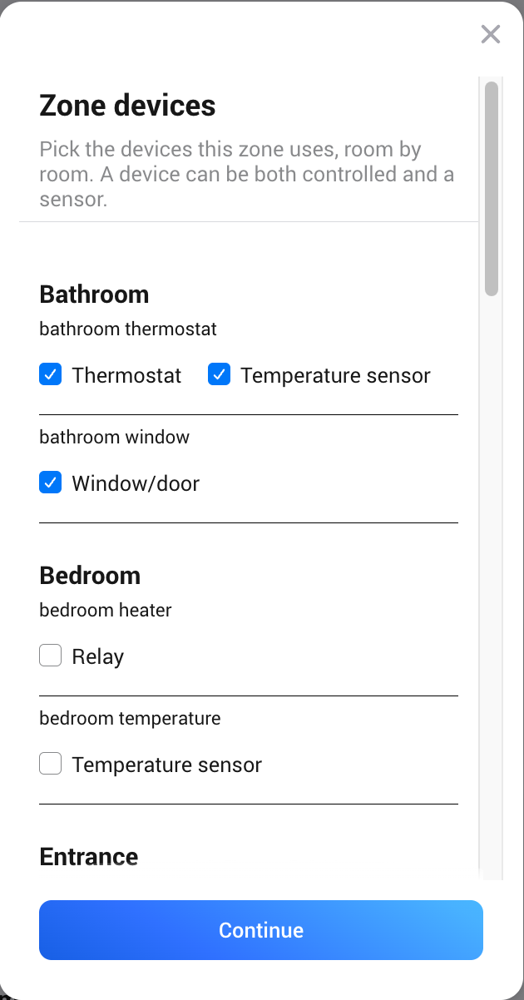
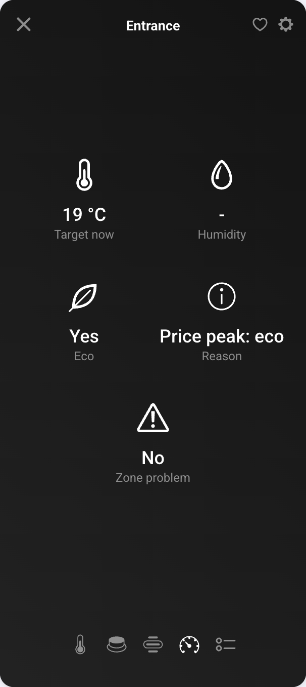

# Heating Zone

To add a zone, give it a name and pick its devices room by room. A device can be both a
controlled device and a sensor. On the second page you set options for each device (see
[Zone devices](Zone-devices)). To change the devices later, use **Repair** in the zone's device
settings.

The zone shows:

- **Comfort heat** and **Eco heat**. Comfort is used when someone is home, eco when nobody is
  home or the price is high. Eco is never warmer than comfort; if you move one past the other,
  both move.
- **Comfort cool** and **Eco cool**, only when the zone has an air conditioner. Eco cool is never
  cooler than comfort cool. A zone without one switches its devices off in the cooling season.
- **Zone mode**: Auto, Manual or Off. In Manual the app leaves the devices alone. Off switches
  the zone's devices off.
- **Boost**: comfort plus the boost amount for the boost time. Press it again to stop early.
- **Target now** (the dial, read only): the temperature the zone aims at right now. Change
  comfort heat and eco heat instead.
- **Follow home**: hours left, shown only while a temporary Follow home runs (see
  [Guests in the guest room](How-to#guests-in-the-guest-room)).
- The zone temperature and humidity, and a **Reason** that explains what the zone does.
- **Heating power**, only when the zone has power meters: the sum of their readings. In Homey
  Energy and Climate, count either the zone or its own devices, not both (see [Setup](Setup)).
- With power meters also **Energy today**, **Cost today** (from the price of each quarter) and
  **Price paid today**: cost per kWh. Compare it with the controller's **Average price today**:
  lower means the zone heated in cheaper hours. They start again at midnight.

## Settings

- **Heat all year**: keeps heating in the cooling and off seasons, for example a bathroom floor.
- **Occupancy**: Follows home, Always eco (for example a guest room) or Always comfort.
- **Low temperature alarm** (default 10 °C, 0 = off).
- **Boost amount** and **Boost time**.
- **Eco after door/window open**: how long a door or window may be open before the zone goes to
  eco (default 2 minutes).
- **At price peaks**: Eco (default), Off (switch the zone's devices off) or Ignore.
- **Heat only when cold outside**, with **Heat below** and **Stop above**.
- **Relay minimum on and off time**.

## Temperature units

Homey shows the dials and temperatures in °C or °F, depending on the location of your Homey.
The reason texts follow the same unit. Zone settings, the configure page and the values in this
app's flow cards are always in °C.
