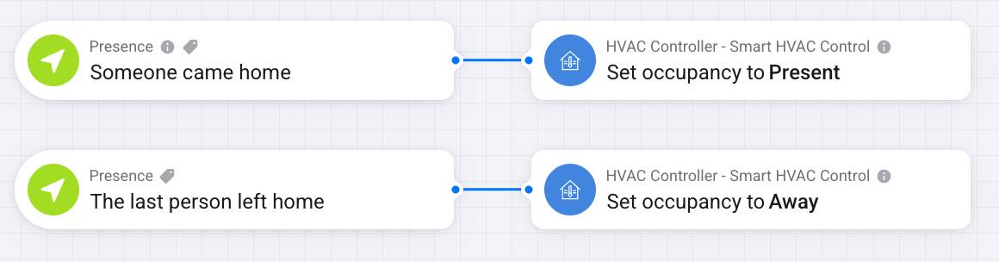
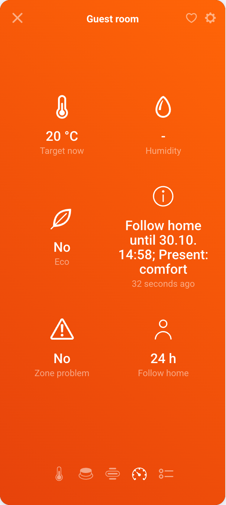

# How to

## Follow who is home

- When someone came home, **Set occupancy** to Present.
- When the last person left, **Set occupancy** to Away.
- Optional: when someone is on the way, for example near home by geofence, **Set occupancy** to
  Coming Home.

All zones react at once. Present and Coming Home give comfort, Away gives eco.

## Guests in the guest room

Set the guest room zone's **Occupancy** to Always eco. When guests come, run **Follow home for
24 hours** on that zone. The room then follows who is home like the other rooms. Each run adds
24 hours, so a button flow can extend the stay one day at a time. The zone shows the hours left
under **Follow home**. When the time runs out, or after **Use own occupancy setting**, the room
goes back to Always eco.

## Save on price peaks

1. Import the prices (see [Prices](Prices)).
2. Choose the price model in the controller settings:
   - **Rate is highest** (default, needs 15-minute prices): only short peaks of one or two
     quarters count, also across the hour. A price must also be at least the **minimum price
     difference** (default 0.01 per kWh) above the local median, so cheap and flat days and small
     bumps have no peaks: a smaller peak only moves the heat by a quarter and saves nothing.
   - **Above average**: every quarter more than the percentage (default 30 %) above today's
     average counts.
3. During a peak the controller shows **Expensive now**. Zones go to eco, or off if their **At
   price peaks** setting is Off, and return when the peak ends. Zones set to Ignore stay as they
   are.

Use **Expensive now changed** or **Price is expensive** for other things that should follow the
price, such as a water heater.

## Heat a room with a heater on a plug or relay

1. In the zone, pick the plug or relay as **Relay** and a temperature sensor in the same room as
   **Sensor**.
2. The zone switches the relay by the relay band around the target. The relay stays on or off
   for at least the **Relay minimum on and off time** (default 5 minutes). In eco the target is
   lower, so the heater stays off until the room cools below it.
3. Without a temperature from an available sensor the relay stays off and the zone shows a
   problem.

If relay off means heating in your wiring, tick **Inverted** for that relay.

## Use an air conditioner or air-to-air heat pump

1. Pick it as **Air conditioner**, and as **Sensor** if it measures the room.
2. On the configure page, choose **Eco**: the eco setpoint, or fan. With fan, the unit switches
   to fan when the zone goes to eco and back when eco ends. During a long absence it heats at the
   eco setpoint instead, because it may be the main heat source, and uses fan only while the room
   is at least 1 °C above eco.
3. The zone now shows **Comfort cool** and **Eco cool**. In the cooling season the unit cools to
   comfort cool, or to eco cool in eco.

If your air conditioner app has fan mode only as its own flow card, use the zone's **Eco
changed** trigger to run that card.

## Save heat while a window is open

Pick the window or door contact as **Window/door** in the zone. When one has been open for the
**Eco after door/window open** time, the zone goes to eco. It returns when all its windows and
doors are closed. Use **Eco changed** if you want a notification.

## Heat a floor only in hard frost

1. Pick your outdoor sensor in the HVAC Controller (when adding it, or with Repair).
2. In the zone, pick the floor's relay as **Relay** with **Relay controls: Heating on/off**. The
   floor's own thermostat keeps the temperature.
3. In the zone settings turn on **Heat only when cold outside**, for example heat below −10 °C
   and stop above −8 °C.

## Boost a room

Press **Boost**, or use **Boost zone** in a flow. The zone heats to comfort plus the **Boost
amount** (default 1 °C) for the **Boost time** (default 60 minutes), whatever the occupancy and
price. Press Boost again to stop. Manual and Off also stop a boost.

## Leave for days

Use **Set long absence until** with the last day of the trip, or press **Long absence** on the
controller. All zones go to eco and nothing cools. Air conditioners set to eco fan keep heating
at the eco setpoint. Long absence ends after the given day. To end it earlier, press **Long
absence** again or use **End long absence**.

## Control a zone manually

Set the zone mode to **Manual**, and the app stops writing to the zone's devices. In Auto, a
setpoint changed manually on a thermostat is put back after 30 minutes.

## Get an alert when a room gets cold

Set the zone's **Low temperature alarm** (default 10 °C). Below it the zone's problem alarm
turns on. The app does not heat because of it. Use the problem alarm in a flow to send a
notification.

## See why a zone does what it does

Each zone shows a **Reason**, for example:

- `Present: comfort` or `Away: eco`
- `Price peak: eco`
- `Boost 22 °C until 07:25`
- `Window open: eco`
- `Season off; <device>: fan`
- `<device>: manual change, restoring later`

The HVAC Controller shows the price reason, for example `Normal` or `Peak (over 0.0668)`. The
**Target changed** trigger has the reason as a token.
