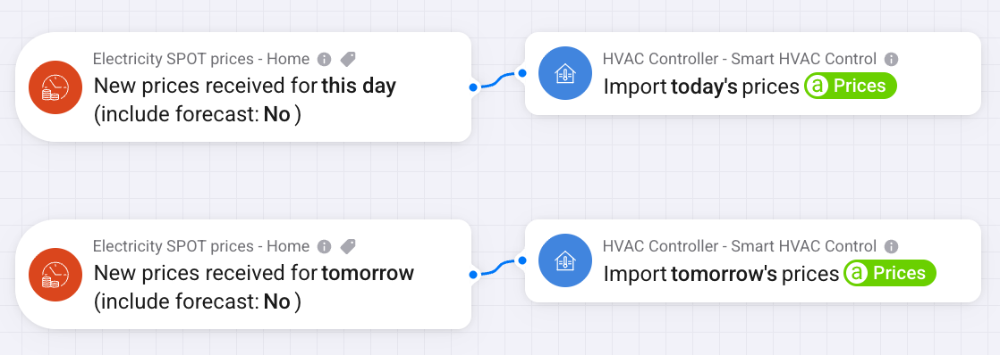

# Prices

Prices are optional. Without them only occupancy decides between comfort and eco.

The app does not read other apps. A flow brings the prices in with the **Import prices** card,
so any price app or script can be the source. The card takes a JSON array of the prices of one
day, from local midnight, in 15- or 60-minute steps. The prices JSON from the Power by the Hour
app works as it is. Choose whether it is today's or tomorrow's prices.

Tomorrow's prices can be partial or missing. Import them again when they are published. The
controller fires **Prices missing for tomorrow** at its check time when they are not complete.

## Example with Power by the Hour

In an advanced flow:

- When **New prices received** for this day, then **Import prices** today's with its Prices
  token.
- When **New prices received** for tomorrow, then **Import prices** tomorrow's with its Prices
  token.
- Every day at 00:05, **Provide import prices JSON** for this day, then **Import prices**
  today's with its Prices token.

Leave **Include forecast prices** off. Forecasts are estimates, not prices.

To choose what counts as a price peak, see [Save on price peaks](How-to#save-on-price-peaks).
