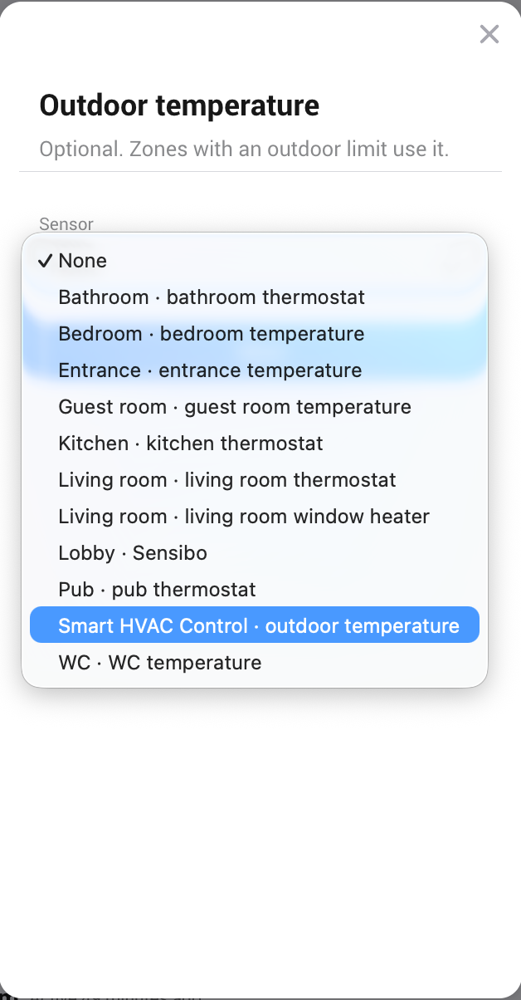

# Setup

1. Add the **HVAC Controller** first. You can add only one, and zones need it. It holds what all
   zones share: occupancy, season, long absence, prices and the outdoor temperature. When you add
   it, you can pick an outdoor temperature sensor. If you try to add a second one, the app points
   you to the existing controller; go on with the zones.

   

2. Add a **Heating Zone** for each room or area, and pick its devices.
3. Make flows that tell the controller who is home (see
   [Follow who is home](How-to#follow-who-is-home)), and optionally flows that import energy
   prices (see [Prices](Prices)).
4. Count everything once in Homey **Energy** and **Climate**. Every device is counted in by default,
   and a device can be excluded in its device settings. The zones and the controller show the
   power and temperatures of devices Homey already counts, so keep one of them and exclude the
   other:
   - **Energy**: count either the power meters, or the zones, or the controller (the sum of the
     zones), never two of these.
   - **Climate**: show either the zone or its own thermostats and sensors.

If the HVAC Controller is removed or unavailable, the zones use its last known state for one
hour. After that they heat to comfort and ignore prices.
