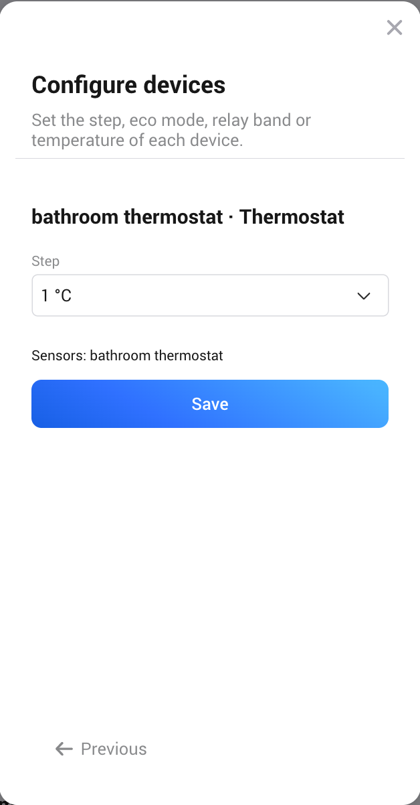
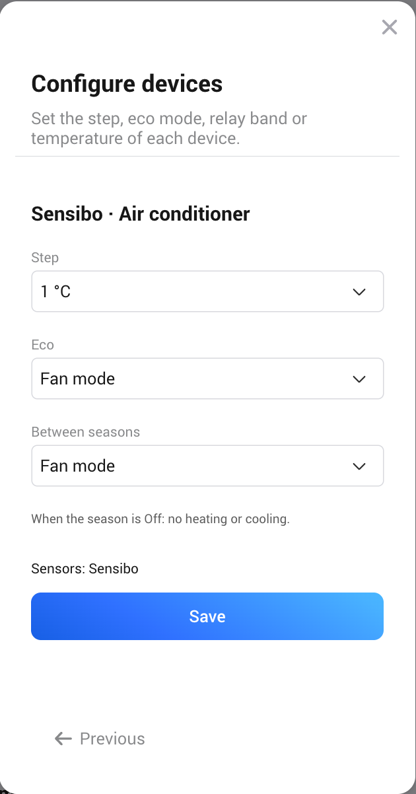

# Zone devices

A zone can have:

- **Thermostats**: any device with a target temperature. To switch one off, the zone uses the
  first it has of: `thermostat_mode` (off, and heat when heating), the on/off switch, or
  `system_mode` (as on Zigbee2MQTT thermostats). It is found out automatically. The zone never
  lowers the setpoint to mean off; a thermostat with none of these is left as it is and the zone
  says so.
- **Relays and smart plugs** that switch a heater.
- **Air conditioners and air-to-air heat pumps**: heat, cool, off, and fan if the device has
  it.
- **Sensors** for temperature and humidity. The zone uses the average of the sensors that are
  available. If a device has several temperatures, for example a thermostat with
  `measure_temperature.local`, choose which one on the configure page.
- **Windows and doors**: contact sensors.
- **Power meters**: devices that measure the power of the zone's heating, such as a heater or plug
  that measures itself, or a separate meter in the heater's supply. The zone only reads them and
  shows their sum as **Heating power**.

Only heating, cooling and room devices are listed (thermostats, heaters, radiators, air
conditioners, heat pumps, relays, plugs, sensors, fans and air purifiers, and devices of the class
Other), so an appliance such as a fridge, oven or water heater can't be picked by mistake.

## Options per device

These are on the configure page, when adding the zone or in Repair.

- **Step**: the setpoint step the device really accepts (1, 0.5 or 0.1 °C). Some thermostats
  say 0.5 but only take whole degrees. The app also notices this from what the device reports.
- **Eco** (air conditioners with fan): use the eco setpoint, or switch to fan.
- **Between seasons** (air conditioners with fan): off or fan while the season is Off.
- **Relay controls**: **Room temperature** switches the relay by the room temperature and the
  relay band. **Heating on/off** is for a heater with its own thermostat: the relay is on at
  comfort and off in eco. No sensor is needed for this.
- **Relay band**: **On below target by** and **Off at target plus**, in °C. With the default 0.3
  and 0.3 and a 21 °C target, the relay switches on at 20.7 °C and off at 21.3 °C. A negative
  off value switches off below the target. Use it for a heater that should only help the main
  heating: on 1.0 and off −0.5 give on at 20.0 °C and off at 20.5 °C.
- **Inverted** (relays): for wiring where relay off means heating.

The app rounds every setpoint to a step the device accepts and keeps it within the device's
limits.
